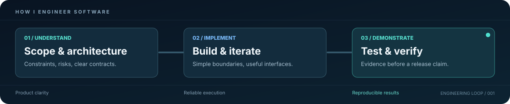

 

**Software Engineer · Full-Stack Products · Native Applications · AI Engineering**

I turn ambitious product ideas into working software, with a particular interest in **architecture, reliability, developer experience, and thoughtful design**.

[**Portfolio ↗**](https://joshsegatt.com) &nbsp;·&nbsp; [**Explore projects ↓**](#selected-work) &nbsp;·&nbsp; [**Engineering approach ↓**](#how-i-work) &nbsp;·&nbsp; [**Email ↗**](mailto:josuesegatofilho@gmail.com)

UK · Switzerland · Working across borders

 

## Software that works beyond the demo

I build across the stack: **TypeScript/React interfaces, APIs and data models, Rust-powered desktop software, Android apps, and tools for AI-assisted engineering**.

My strongest interest is the point where product decisions meet technical risk: an interface should feel effortless, a system should behave predictably, and a release should have evidence behind it. I'm drawn to practical software, not complexity for its own sake.

## Featured: SeniorOS

**An engineering layer for coding agents that makes verification part of the workflow.**

SeniorOS uses selective skills, risk boundaries, structured checks, and reproducible evaluations. Its published benchmark compares the same coding tasks across configurations and models, including Claude, Grok, and Gemini. The goal is not more confident AI output. It's **better diagnosis, safer changes, and evidence a reviewer can inspect**.

Recorded comparison · <a href="https://github.com/joshsegatt/SeniorOS/blob/main/evals/bench/README.md">Read the methodology and limitations</a> · <a href="https://github.com/joshsegatt/SeniorOS">Explore SeniorOS</a>

## Selected work

| Project | Problem I'm solving | Engineering focus |
| :--- | :--- | :--- |
| **[SeniorOS](https://github.com/joshsegatt/SeniorOS)** | Coding agents need reliable engineering workflows, not just instructions. | Agent tooling, guardrails, benchmarks, verification |
| **[chit](https://github.com/joshsegatt/chit)** | AI-generated patches shouldn't ship on an unverified “tests pass” claim. | Isolated Git worktrees, red/green proof, deterministic gates |
| **[Segatt Tools](https://github.com/joshsegatt/Segatt-Tools)** | Windows maintenance without unnecessary cloud dependence. | Rust, Tauri, local AI, privacy-first desktop tooling |
| **[Batimoving B2B](https://github.com/joshsegatt/Batimoving-b2b)** | Moving logistics and lead workflows need coherent business rules. | Marketplace architecture, transactional workflows, Swiss operations |
| **[Finora](https://github.com/joshsegatt/Finora)** | Track spending and scan receipts without needing an account. | Kotlin, Jetpack Compose, Room, on-device OCR |
| **[Sable](https://github.com/joshsegatt/Sable-Overlay-Gamer)** | Make gaming performance telemetry useful in real time. | Rust, Tauri, Windows telemetry, overlays |
| **[PriceCompass](https://github.com/joshsegatt/PriceCompass)** | Make recurring UK household costs easier to understand. | React, NestJS, PostgreSQL, Prisma |

More product work: <a href="https://github.com/joshsegatt/batimove.ch">Batimove</a> · <a href="https://github.com/joshsegatt/CVLetterAI">CVLetterAI</a> · <a href="https://github.com/joshsegatt/LabelGuardUK">LabelGuard UK</a> · <a href="https://github.com/joshsegatt/LocationMonteCharge.ch">Monte Charge</a>

## How I work

I prefer **small, explainable systems** over impressive-looking diagrams with no operational value.

- **Product first:** understand the actual user, the constraints, and what success means.
- **Engineering discipline:** clear boundaries, explicit state, sensible data models, and reversible changes.
- **Verification over optimism:** test behavior, investigate root causes, and document what remains uncertain.
- **Design with intent:** interfaces that communicate clearly, with motion only when it adds meaning.

## Tools I reach for

| Layer | Stack |
| :--- | :--- |
| **Interfaces** | TypeScript, React, Next.js, Tailwind CSS, Vite |
| **Backend & data** | Node.js, NestJS, PostgreSQL, Prisma, Drizzle |
| **Native & mobile** | Rust, Tauri, Kotlin, Jetpack Compose |
| **AI & tooling** | Model integrations, agent workflows, evaluation harnesses, local inference |
| **Shipping** | Docker, GitHub Actions, Vercel |

## Build something worth shipping

I'm interested in **software engineering contracts, product collaborations, native tooling, and AI developer infrastructure**. If the problem requires both a useful product and a serious engineering foundation, let's talk.

**[joshsegatt.com](https://joshsegatt.com) &nbsp;·&nbsp; [josuesegatofilho@gmail.com](mailto:josuesegatofilho@gmail.com)**

Built with intent. Tested with evidence. Improved in public.

