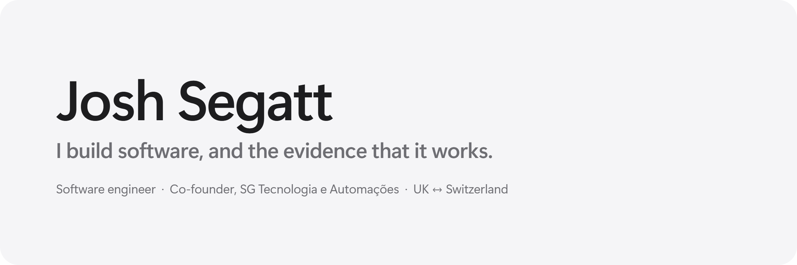
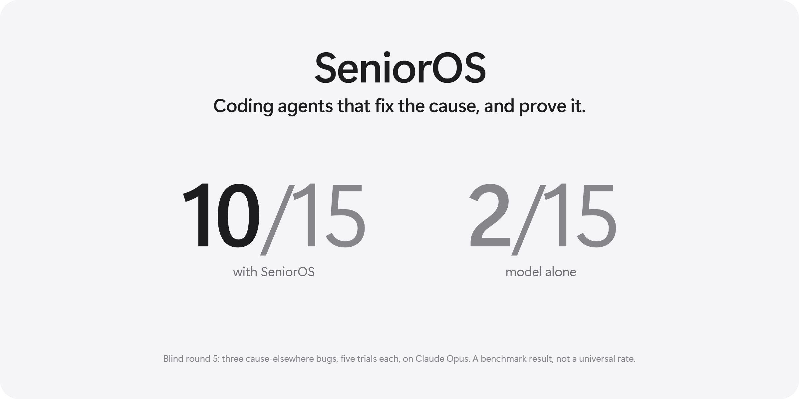
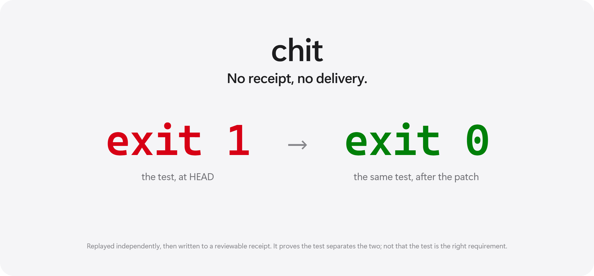
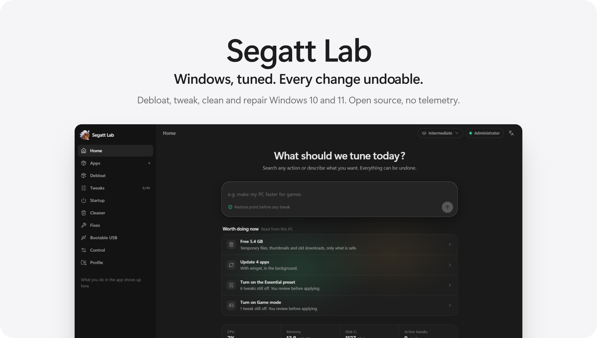
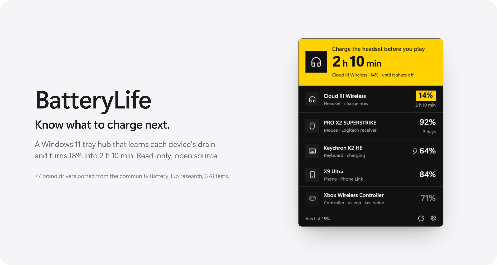

<picture>
  <source media="(prefers-color-scheme: dark)" srcset="./assets/hero-dark.png">
  
</picture>

I take software from the product question to a verified release: what the person needs, the architecture that serves it, the implementation, and the proof that it works. Web platforms, native apps for Windows, Android and iOS, and tools that make AI coding agents accountable.

 

<picture>
  <source media="(prefers-color-scheme: dark)" srcset="./assets/seniorOS-dark.png">
  
</picture>

[Source](https://github.com/joshsegatt/SeniorOS) &nbsp;·&nbsp; [Methodology and caveats](https://github.com/joshsegatt/SeniorOS/tree/main/evals/bench) &nbsp;·&nbsp; [Watch a recorded run](https://github.com/joshsegatt/SeniorOS/blob/main/brand/social/proof.mp4)

 

<picture>
  <source media="(prefers-color-scheme: dark)" srcset="./assets/chit-dark.png">
  
</picture>

[Source, protocol and limitations](https://github.com/joshsegatt/chit)

 

<picture>
  <source media="(prefers-color-scheme: dark)" srcset="./assets/segatt-lab-dark.png">
  
</picture>

[Download](https://github.com/joshsegatt/Segatt-Lab/releases/latest) &nbsp;·&nbsp; [Website](https://joshsegatt.github.io/Segatt-Lab/) &nbsp;·&nbsp; [Source](https://github.com/joshsegatt/Segatt-Lab)

 

<picture>
  <source media="(prefers-color-scheme: dark)" srcset="./assets/batterylife-dark.png">
  
</picture>

[Download](https://github.com/joshsegatt/BatteryLife/releases/latest) &nbsp;·&nbsp; [Source](https://github.com/joshsegatt/BatteryLife)

 

<picture>
  <source media="(prefers-color-scheme: dark)" srcset="./assets/finora-dark.png">
  
</picture>

[SG Tecnologia e Automações](https://github.com/sg-tecnologia-automacoes)

 

<b>Other work</b>

 

**[Sable](https://github.com/joshsegatt/Sable-Overlay-Gamer)** — gaming telemetry and an in-game overlay, in beta. Rust, Tauri, Windows ETW. 
**[PriceCompass](https://github.com/joshsegatt/PriceCompass)** — household bills and plan comparisons in the UK. React, NestJS, PostgreSQL. 
**[Monte Charge](https://github.com/joshsegatt/LocationMonteCharge.ch)** — desktop logistics hub for Swiss operations. Tauri, Rust. 
**[Batimove](https://github.com/joshsegatt/batimove.ch)**, **[CVLetterAI](https://github.com/joshsegatt/CVLetterAI)**, **[LabelGuard UK](https://github.com/joshsegatt/LabelGuardUK)**, **[UK TaxSaver](https://github.com/joshsegatt/UK-TaxSaver)** — web products for Swiss and UK markets. TypeScript, Next.js.

### How I work

Start from the person: the outcome, the constraints, and what the change must not break. 
Treat architecture as trade-offs. Small boundaries and reversible steps beat complexity added for appearance. 
Make verification repeatable: a failing baseline, the real test command, an artifact someone else can inspect. 
State the limits. A benchmark is a benchmark. A beta is a beta.

TypeScript · React · Next.js · NestJS · PostgreSQL · Rust · Tauri · Kotlin Multiplatform · Compose · Flutter · Python · GitHub Actions

### Contact

[joshsegatt.com](https://joshsegatt.com) &nbsp;·&nbsp; [Email](mailto:josuesegatofilho@gmail.com) &nbsp;·&nbsp; [SG Tecnologia e Automações](https://github.com/sg-tecnologia-automacoes)
