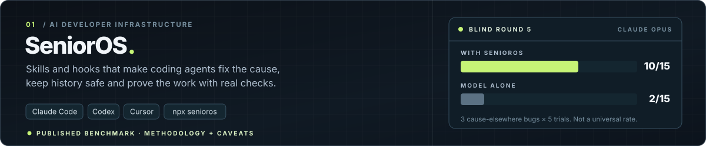
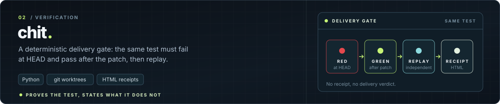
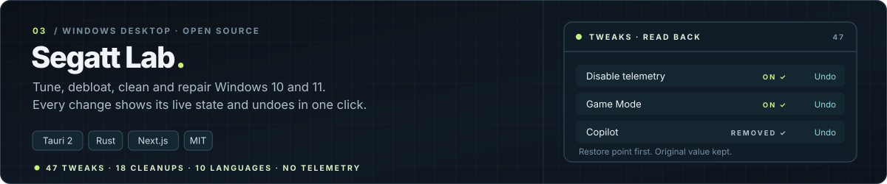
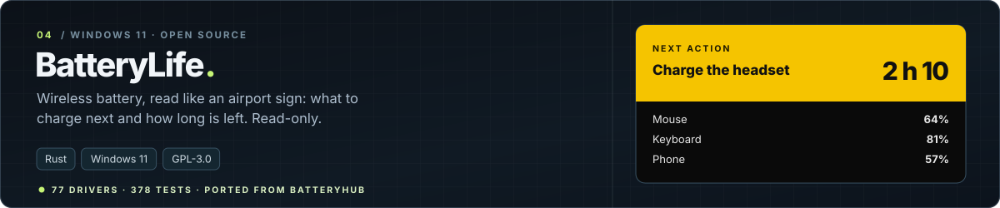
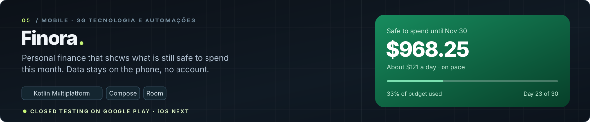
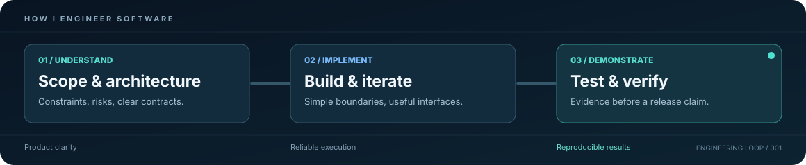

 

**Software engineer** · Product systems · Native apps · AI developer infrastructure 
Co-founder of **[SG Tecnologia e Automações](https://github.com/sg-tecnologia-automacoes)**

[**Selected work**](#selected-work) &nbsp;·&nbsp; [**Evidence**](#evidence) &nbsp;·&nbsp; [**Principles**](#principles) &nbsp;·&nbsp; [**Contact**](#contact)

I take software from the product question to a verified release: what the person needs, the architecture that serves it, the implementation, and the evidence that it works. Web platforms, native apps for Windows, Android and iOS, and tooling that makes AI coding agents accountable.

## Selected work

&nbsp;[Source](https://github.com/joshsegatt/SeniorOS) · [Methodology & caveats](https://github.com/joshsegatt/SeniorOS/tree/main/evals/bench) · [Leaderboard](https://github.com/joshsegatt/SeniorOS/blob/main/evals/bench/LEADERBOARD.md)

&nbsp;[Source, protocol & limitations](https://github.com/joshsegatt/chit) · [Example red/green evidence](https://github.com/joshsegatt/chit/blob/main/docs/redgreen.jpg)

&nbsp;[Download](https://github.com/joshsegatt/Segatt-Lab/releases/latest) · [Website](https://joshsegatt.github.io/Segatt-Lab/) · [Source](https://github.com/joshsegatt/Segatt-Lab)

&nbsp;[Download](https://github.com/joshsegatt/BatteryLife/releases/latest) · [Source](https://github.com/joshsegatt/BatteryLife) · Device protocols from the community [BatteryHub](https://github.com/krisgfx9/Wireless-Device-Battery-Monitor) research

&nbsp;Built with [SG Tecnologia e Automações](https://github.com/sg-tecnologia-automacoes) · Screens use demo data

<b>More projects</b>

 

| Project | What it addresses | Built with |
| :--- | :--- | :--- |
| **[Sable](https://github.com/joshsegatt/Sable-Overlay-Gamer)** | Gaming telemetry and an in-game performance overlay (beta). | Rust · Tauri · Windows ETW · React |
| **[PriceCompass](https://github.com/joshsegatt/PriceCompass)** | Household bills and plan comparisons in the UK. | React · NestJS · PostgreSQL · Prisma |
| **[Monte Charge](https://github.com/joshsegatt/LocationMonteCharge.ch)** | Desktop logistics hub for Swiss operations. | Tauri · Rust |
| **Batimoving B2B** | Moving and cleaning lead workflows for the Swiss market (private). | TypeScript |
| **[Batimove](https://github.com/joshsegatt/batimove.ch)** · **[CVLetterAI](https://github.com/joshsegatt/CVLetterAI)** · **[LabelGuard UK](https://github.com/joshsegatt/LabelGuardUK)** · **[UK TaxSaver](https://github.com/joshsegatt/UK-TaxSaver)** | Web products for Swiss and UK markets. | TypeScript · Next.js |

## Evidence

A claim about an agent is only as good as the run behind it. These are recorded, not staged.

SeniorOS, recorded side by side. <a href="https://github.com/joshsegatt/SeniorOS/blob/main/brand/social/proof.mp4">Watch the 60-second comparison ↗</a>

**Measured, with scope.** In the fifth blind round, 3 cause-elsewhere bug tasks × 5 trials on Claude Opus: **10/15** runs with SeniorOS, **2/15** for the model alone. One task had an ambiguous expected rule that no configuration passed. A benchmark result, not a universal success rate.

**What chit proves, and what it does not.** That the specified test separates the baseline from the patch. Not that the test encodes the right requirement.

## Principles

| | |
| :--- | :--- |
| **Start from the person** | Define the outcome, the constraints, and what the change must not break. |
| **Architecture is trade-offs** | Small boundaries, explicit states and reversibility beat complexity added for appearance. |
| **Verification is repeatable** | Failing baselines, real test commands, artifacts another engineer can inspect. |
| **Limits are stated** | A benchmark is a benchmark. A beta is a beta. A passing test is not every requirement. |

 

<b>Web & API</b> TypeScript · React · Next.js · NestJS · PostgreSQL &nbsp;|&nbsp; <b>Native & mobile</b> Rust · Tauri · Kotlin Multiplatform · Compose · Flutter &nbsp;|&nbsp; <b>AI tooling</b> agent workflows · local inference · evaluation harnesses &nbsp;|&nbsp; <b>Delivery</b> GitHub Actions · Vercel · Google Play

## Contact

Reviewing my work as an engineer? Start with the **[SeniorOS methodology](https://github.com/joshsegatt/SeniorOS/tree/main/evals/bench)** or **[chit's verification contract](https://github.com/joshsegatt/chit)**.

### [joshsegatt.com ↗](https://joshsegatt.com) &nbsp;·&nbsp; [Email me ↗](mailto:josuesegatofilho@gmail.com)

UK ↔ Switzerland · Remote collaboration

 

Design the product. Engineer the system. Show the evidence.

